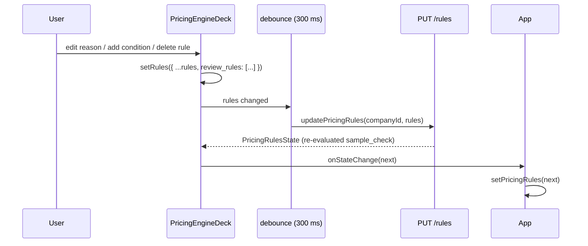

# Editable review rules

The **"Held for review when"** section in Stage 4 (`PricingEngineDeck`) is an editor: add a rule, edit its conditions and reason, delete it — the same UX and data flow as the ledger variables editor. A rule left without conditions, or with an empty reason, blocks Proceed until it is finished.

Paths relative to repo root. UI spec: [../ui.md](../ui.md) §3.4. Rule schema: [pricing-engine.md](pricing-engine.md).

## Background

`review_rules` in `PricingRules` is an array of `ReviewRule`:

```ts
interface ReviewRule { when: Cond[]; reason: string }
interface Cond { var: string; op: CompareOp; value_var?: string; value?: Cell; values?: Cell[] }
```

At Stage 5 (`generateProposal`), the pricing calculator evaluates every rule and pushes matching ones into `evaluation.needs_review`. A non-empty `needs_review` marks the proposal a draft and shows the red **Draft** box to the human reviewer; the document is still built.

The full `PricingRules` object (including `review_rules`) round-trips through `PUT /rules`; the editor needs no backend change.

## Design decisions

| Decision | Choice |
|---|---|
| Editing level | Full structural: add, edit conditions + reason, delete |
| Save mechanism | Auto-save with 300 ms debounce (same as ledger) |
| New rule default | Empty condition (`when: []`), reason `""` |
| UX expansion pattern | Click a rule row → inline tray expands below it (same as ledger variable rows) |
| Always-show section | Yes — header + "Add rule" button visible even when `review_rules` is empty |
| Downstream result | Editing review rules does not clear the last Stage 5 result on screen; the next Generate uses the updated rules. No wipe, no rewind. |
| Empty `when: []` | Stripped before PUT + Proceed blocked while one exists. A half-created rule can never Draft-block proposals. |
| Empty `reason` | Required: `trim(reason) !== ""`, `maxLength={200}` attribute only, no counter UI. Empty → inline hint + Proceed blocked. |
| Condition editor | Shared `CondRows` with a unit filter; the review editor does not import `LedgerTray`. |
| Row identity | Client-only UUID: normalize on load + on add, stripped before PUT. No backend change. |
| Validation display | Top band + red border + auto-expand the offending row via the `review_rules[N]` path. |

## Behaviour

### Adding a rule

The section is always visible. **Add rule** appends `{ when: [], reason: "" }`, opens its tray, and shows an amber "no conditions" warning. The row is highlighted while incomplete.

### Editing a rule

- Conditions: the shared `CondRows` editor builds `var / op / value` rows. The variable dropdown hides `text` and `rows` units. "When (all conditions must hold)".
- Reason: a single-line input, trimmed for validation, capped at 200 characters. Placeholder suggests a short human explanation.
- Delete: a delete action in the tray removes the rule and clears the selection.

### Saving

Every edit updates local state and starts the existing 300 ms debounce. Before `PUT /rules`, the payload drops rules with `when: []` and strips the client-only `_id`. The response replaces `sample_check` and `evaluation`. The existing in-flight guard keeps the trailing edit; the next debounce catches it.

### Blocking Proceed

`reviewBlocked` is true while any rule has no conditions or an empty reason; Proceed is disabled while it (or a structural `errors` list) is non-empty. The top validation band names the problem, the row gets a red border, and the tray auto-expands. A rule that is merely incomplete cannot reach the backend because it is stripped from the save payload.

### Stage 5 after an edit

Editing review rules changes only the rules, not the template or variables. The app does not clear the last Stage 5 result, so the previous proposal and its Draft box stay on screen unchanged; generating again evaluates the review rules as they are and shows the updated reasons.

### Backend validation

Removing a ledger variable that a review rule references surfaces a `ValidationError` from the debounced PUT and appears in the general errors band. Nothing is persisted on a 400.

## Data flow



## Edge cases

| Case | Behaviour |
|---|---|
| Rule with `when: []` | Amber row + tray warning. Stripped from PUT; Proceed blocked until conditions are added or the rule is deleted. Can never Draft-block proposals. |
| Rule with empty `reason` | Inline "reason required" hint, `maxLength={200}` with no counter UI. Proceed blocked until filled. |
| `selectedRule` points to a deleted row | Impossible by construction: selection keys off the client-only `_id`; delete clears the selection. |
| Deleting the only rule | The section falls back to the empty-state hint + "Add rule" button. |
| Editing while PUT is in flight | The existing `lastSaved` guard handles it; the next debounce catches the trailing edit. |
| Variable removed that a rule references | The backend validator returns a `ValidationError`; it appears in the general errors band. |

## Where it lives

| File | Responsibility |
|---|---|
| `frontend/src/components/pricing/CondRows.tsx` | Shared condition rows + `OPS`, with the unit filter that hides `text`/`rows` for review rules |
| `frontend/src/components/pricing/LedgerTray.tsx` | Imports the shared `CondRows`; existing call sites unchanged |
| `frontend/src/components/pricing/PricingEngineDeck.tsx` | Rule editor, client-only `_id`, save guards, row-error highlight |

Backend: `PUT /rules`, no schema change. Dependencies: none. State: a local rules copy plus a client-only `_id`; no counter UI and no persisted ids.

## Verification

1. Open Stage 4 after compiling pricing rules.
2. **Empty state** — a company with no review rules shows the section with "Add rule" and the empty-state text.
3. **Add a rule** — the new row appears, its tray auto-opens, and the amber "no conditions" warning shows.
4. **Add a condition** — choose variables in the tray; the warning disappears; "Saved ✓" appears within ~300 ms.
5. **Edit a reason** — typing fires the debounced save.
6. **Delete a rule** — the row disappears and the save fires.
7. **Invalid reference** — add a condition naming a non-existent variable through the DevDock JSON; the validation error surfaces in the general errors band.
8. **Stage 5 Draft box** — generate a proposal that triggers the rule and confirm the box shows the edited `reason`.
9. **Stage 5 after an edit** — edit a rule after generating; the old proposal stays on screen unchanged, and generating again applies the edited rule.
